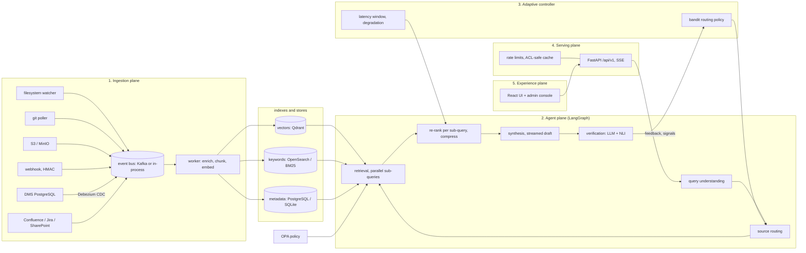

# Architecture

Enterprise Fabric AI follows the five planes of the specification. Every backend sits
behind a small interface (`app/ports/`), with one adapter per profile (`app/adapters/lite`,
`app/adapters/full`). Agents and the API depend only on the interfaces, which is how
indexes, stores and providers can be swapped without rewriting the system.

## 1. Ingestion plane (spec 5, 7.1, 7.2)
- **Change events:** every change becomes a `DocumentChanged` event on the event bus.
  - **Sources:** a file, a Git commit, an S3 object, a webhook call, a DMS row through
    Debezium, or a Confluence, Jira or SharePoint item.
- **One consumer:** `app/ingest/worker.py` is the only consumer. From the same event it
  enriches the document, updates the metadata store and both indexes, so the indexes stay
  consistent.
  - Enrichment adds owner, classification, timestamp and ACL.
  - Processing is idempotent by document and content hash.
- **Chunking:** chunks have stable ids, and only changed chunks are re-embedded. Chunking
  profiles are per source type and recorded on each chunk.
- **Scheduled jobs:** Prefect runs reconciliation, the nightly retrieval evaluation and
  gate, the routing-policy proposal, the retention purge and the weekly review sample.

## 2. Agent plane (spec 7.3-7.8)
- **Query understanding:** the intent (7 classes), the entities and 1-3 sub-queries;
  user questions are scanned for injection.
- **Light path:** simple factual questions skip compression and use fewer candidates.
- **Routing:** the rule router, or a learned bandit policy version.
  - Engagement denial runs first and is never learned.
  - Restricted text goes only to the private model, or nowhere.
- **Retrieval:**
  - access pre-filters inside both indexes, then OPA for every candidate;
  - dense and keyword search per sub-query, in parallel;
  - weighted RRF, recency and superseded weighting, follow-up retrieval;
  - every score multiplier recorded in `retrievals`.
- **Re-rank and compress:** a cross-encoder per sub-query; compression copies relevant
  sentences verbatim; exploratory questions expand to the parent chunk.
- **Synthesis:** the draft streams token by token; every factual sentence cites a chunk,
  and the cited span is recorded.
- **Verification:** each claim is checked by the LLM verifier and an NLI model.
  - A claim the NLI model contradicts but the LLM accepts is kept and flagged.
  - Below 0.6 confidence: one retry, then a clarifying question or escalation.
- **Step budgets:** they cap calls, tokens, seconds and retrieval rounds.

## 3. Adaptive controller (spec 8)
- **Query type:** sets the retriever weights, candidate counts and chunk level.
- **Source freshness:** recent changes get a boost.
- **Observed quality:** a Thompson-sampling bandit. Its policy versions are learned from
  the logs and activated only with a passing replay.
- **Load:** the p95 latency window cuts candidates and skips optional checks for
  low-risk questions only, and the answer says so.

## 4. Serving plane (spec 10)
- **API:** FastAPI `/api/v1` (reference: [api/REFERENCE.md](api/REFERENCE.md)), with
  Server-Sent Events for answers.
- **Identity:** bearer tokens, Keycloak JWTs in `full`.
- **Limits:** token-bucket rate limits per user and IP.
- **Cache:** responses are cached by question plus access fingerprint, index version and
  prompt and policy versions.
- **Concurrency:** there is no global lock; only index writes are serialised.

## 5. Experience plane (spec 11, 7.10)
- **Answer view (React):**
  - the draft streams, then claim verdicts arrive;
  - citations with the cited span highlighted;
  - confidence, superseded and reduced-checking badges;
  - feedback and implicit signals.
- **Admin console:** sources, classification policies, agent performance, traces, and
  prompt and routing rollback.

## Cross-cutting
- **Security:**
  - OPA policies (`policy/`);
  - masking before traces, logs and feedback;
  - a retention purge;
  - an append-only audit log;
  - retrieved text treated as untrusted data.
- **Observability:** OpenTelemetry traces to Langfuse, and Prometheus metrics with
  Grafana dashboards and alerts.
- **Deployment and CI:** Docker images, a Helm chart (tested on kind), and GitHub Actions
  CI/CD with scans and quality gates. See [OPERATIONS.md](OPERATIONS.md).

## Profiles
| | lite | full |
|---|---|---|
| Metadata | SQLite | PostgreSQL 16 (Alembic) |
| Vectors | embedded Qdrant | Qdrant server |
| Keywords | rank_bm25 | OpenSearch |
| Events | in-process queue | Kafka (KRaft) + Debezium |
| Cache, limits | in-process | Redis |
| Identity | email and password | Keycloak (OIDC/JWT) |
| Policy | the same rules in code | OPA |
