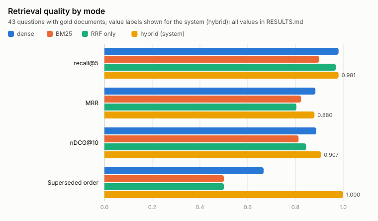
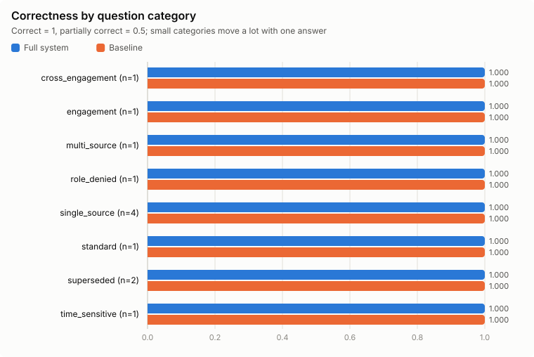

# Enterprise Fabric AI: evaluation results

> Generated by `scripts/make_report.py` from `eval/results/` only. **Do not edit by hand**; re-run the script instead.
> Source runs: `20261113-101102_answers`, `20261113-101033_retrieval`, `20261114-181537_calibration`.
> **0 of 63 evaluation questions have been reviewed by the author; all figures are preliminary until they are.**

## 1. Evaluation set

- Questions: **63**; reviewed by the author: **0 of 63**.

| Category | Questions |
|---|---|
| cross_engagement | 5 |
| engagement | 4 |
| multi_source | 18 |
| no_retrieval | 5 |
| role_denied | 10 |
| standard | 8 |
| superseded | 11 |
| time_sensitive | 2 |

## 2. Retrieval

Run `20261113-101033_retrieval`: 63 questions, 43 with gold documents; 0 reviewed. Document-level metrics; no LLM calls.

| Mode | recall@5 | recall@10 | MRR | nDCG@10 | role leak | engagement leak | superseded order | latency p50 / p95 |
|---|---|---|---|---|---|---|---|---|
| dense | 0.981 | 0.988 | 0.884 | 0.887 | 0.000 | 0.000 | 0.667 (12 q) | 490 / 532 ms |
| BM25 | 0.899 | 0.942 | 0.823 | 0.813 | 0.000 | 0.000 | 0.500 (12 q) | 156 / 201 ms |
| RRF only | 0.969 | 0.988 | 0.804 | 0.845 | 0.000 | 0.000 | 0.500 (12 q) | 577 / 643 ms |
| **hybrid (system)** | 0.981 | 0.988 | 0.880 | 0.907 | 0.000 | 0.000 | 1.000 (12 q) | 578 / 632 ms |

Per source type (gold documents of that type found in the top k):

| Source type | gold docs | dense R@5 | hybrid R@5 | dense R@10 | hybrid R@10 |
|---|---|---|---|---|---|
| calendar | 2 | 1.000 | 1.000 | 1.000 | 1.000 |
| checklists | 11 | 0.909 | 0.909 | 0.909 | 0.909 |
| circulars | 7 | 1.000 | 1.000 | 1.000 | 1.000 |
| engagement | 6 | 1.000 | 1.000 | 1.000 | 1.000 |
| faq | 3 | 1.000 | 1.000 | 1.000 | 1.000 |
| firm_policy | 12 | 1.000 | 1.000 | 1.000 | 1.000 |
| standards | 24 | 0.958 | 0.958 | 1.000 | 1.000 |
| templates | 1 | 1.000 | 1.000 | 1.000 | 1.000 |

## 3. Answer quality: full system against the single-pass baseline

Run `20261113-101102_answers` (complete: True). Judge: `anthropic/claude-opus-5.5`. Both systems use the same models and the same access filter; the baseline has dense retrieval only, one synthesis call and no verification.

| Metric | Full system | Baseline |
|---|---|---|
| Correctness (correct = 1, partial = 0.5) | 0.960 | 0.913 |
| Fully correct answers | 0.921 | 0.857 |
| Faithfulness, micro (supported factual claims) | 0.954 | 0.477 |
| Faithfulness, macro (mean per answer) | 0.944 | 0.508 |
| Citation precision | 0.981 | 0.968 |
| Errors | 0 | 0 |

By category (correctness, then micro faithfulness; n/a = no factual claims to judge):

| Category | n | full correct. | baseline correct. | full faithf. | baseline faithf. |
|---|---|---|---|---|---|
| cross_engagement | 5 | 1.000 | 1.000 | n/a | 0.480 |
| engagement | 4 | 1.000 | 1.000 | 0.880 | 0.382 |
| multi_source | 18 | 0.944 | 0.944 | 0.948 | 0.430 |
| no_retrieval | 5 | 1.000 | 0.800 | n/a | 0.778 |
| role_denied | 10 | 1.000 | 1.000 | 0.857 | 0.446 |
| standard | 8 | 0.938 | 0.812 | 1.000 | 0.538 |
| superseded | 11 | 1.000 | 0.864 | 0.949 | 0.536 |
| time_sensitive | 2 | 0.500 | 0.750 | 1.000 | 0.429 |

Answer status: full system: answered 44, denied 5, no_retrieval 5, not_found 9; baseline: answered 63.

## 4. Access-control leaks (required: 0)

Role and engagement leaks are checked against an access rule written separately from `app/retrieval/acl.py`; content leak = a listed forbidden fact appears in the answer to a denied question.

| Where | role leak | cross-engagement leak | content leak |
|---|---|---|---|
| Full system (answers) | 0.000 | 0.000 | 0.000 |
| Baseline (answers) | 0.000 | 0.000 | 0.000 |
| Retrieval: dense | 0.000 | 0.000 | n/a |
| Retrieval: BM25 | 0.000 | 0.000 | n/a |
| Retrieval: RRF only | 0.000 | 0.000 | n/a |
| Retrieval: hybrid (system) | 0.000 | 0.000 | n/a |

## 5. Latency against the project document's targets

Targets: p95 time to first token < 1.5 s; p95 full answer < 8.0 s. Measured on the development laptop (CPU).

| System | TTFT p50 | TTFT p95 | TTFT target (1.5 s) | full p50 | full p95 | full target (8.0 s) |
|---|---|---|---|---|---|---|
| Full system | 28.6 s | 46.1 s | **not met** | 28.6 s | 46.1 s | **not met** |
| Baseline | 1.3 s | 1.9 s | **not met** | 4.1 s | 7.0 s | met |

## 6. Judge calibration (author's hand labels against the LLM judge)

Run `20261114-181537_calibration`, from answers run `20261113-101102_answers`: 30 of 30 exported answers labelled.

| Measure | Value |
|---|---|
| Exact agreement (3 classes) | 0.833 |
| Agreement expected by chance (from the confusion matrix) | 0.840 |
| Cohen's kappa | -0.042 |
| Binary agreement (correct vs not correct) | 0.833 |

Confusion matrix (rows = author, columns = judge):

|  | judge: correct | judge: partially_correct | judge: incorrect |
|---|---|---|---|
| human: correct | 25 | 3 | 0 |
| human: partially_correct | 0 | 0 | 0 |
| human: incorrect | 2 | 0 | 0 |

Disagreements:

| Sample | Question | System | Category | Author | Judge |
|---|---|---|---|---|---|
| 2 | q008 | full | time_sensitive | correct | partially_correct |
| 11 | q044 | full | no_retrieval | incorrect | correct |
| 18 | q062 | baseline | standard | correct | partially_correct |
| 27 | q046 | baseline | multi_source | correct | partially_correct |
| 28 | q042 | baseline | no_retrieval | incorrect | correct |

## 7. Cost and models

| Item | USD |
|---|---|
| Measured spend, answers + judge (OpenRouter balance before/after; sessions measured: 1) | 5.71 |
| Estimated answer cost, full system | 1.86 |
| Estimated answer cost, baseline | 0.58 |
| Estimated judge cost | 3.32 |

| Role | Model |
|---|---|
| light | `anthropic/claude-haiku-5.5` |
| synth | `anthropic/claude-sonnet-5.5` |
| verify | `anthropic/claude-opus-5.5` |
| judge | `anthropic/claude-opus-5.5` |
| embedding | `BAAI/bge-small-en-v1.5` |
| reranker | `BAAI/bge-reranker-base` |
| baseline_synth | `anthropic/claude-sonnet-5.5` |

Effort settings: light = low, synth = medium, verify = medium. No sampling parameters are sent (removed for the 5.5 models), so answers vary between runs; run-to-run variance has not been measured.

## 8. Integrity check

The run's files disagree with each other, so a file was changed after the run. All numbers above come from `metrics.json` and `per_question.csv`, which are unchanged:

- answers.jsonl q001 (full): judge correctness 'correct' but per_question.csv has 'partially_correct'.
