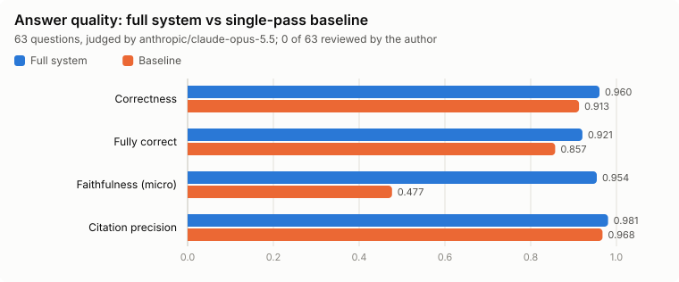
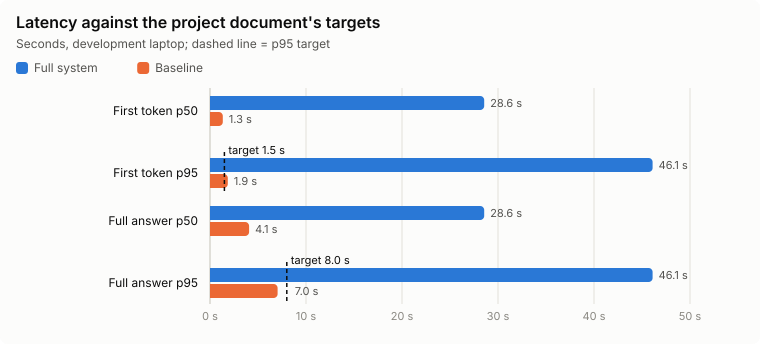

# Enterprise Fabric AI: evaluation results

> Generated by `scripts/make_report.py` from `eval/results/` only. **Do not edit by hand**; re-run the script instead.
> Source runs: `20261121-183054_answers`, `20261121-153910_retrieval`, `20261121-192337_calibration`.
> **0 of 12 evaluation questions have been reviewed by the author; all figures are preliminary until they are.**

## 1. Evaluation set

- Questions: **12**; reviewed by the author: **0 of 12**.

| Category | Questions |
|---|---|
| cross_engagement | 1 |
| engagement | 1 |
| multi_source | 1 |
| role_denied | 1 |
| single_source | 4 |
| standard | 1 |
| superseded | 2 |
| time_sensitive | 1 |

## 2. Retrieval

Run `20261121-153910_retrieval`: 147 questions, 125 with gold documents; 0 reviewed. Document-level metrics; no LLM calls.

| Mode | recall@5 | recall@10 | MRR | nDCG@10 | role leak | engagement leak | superseded order | latency p50 / p95 |
|---|---|---|---|---|---|---|---|---|
| dense | 0.961 | 0.980 | 0.821 | 0.849 | 0.000 | 0.000 | 0.667 (18 q) | 587 / 1334 ms |
| BM25 | 0.941 | 0.968 | 0.815 | 0.837 | 0.000 | 0.000 | 0.611 (18 q) | 206 / 486 ms |
| RRF only | 0.973 | 0.992 | 0.808 | 0.850 | 0.000 | 0.000 | 0.611 (18 q) | 699 / 1318 ms |
| **hybrid (system)** | 0.981 | 0.996 | 0.852 | 0.884 | 0.000 | 0.000 | 1.000 (18 q) | 696 / 1388 ms |

Per source type (gold documents of that type found in the top k):

| Source type | gold docs | dense R@5 | hybrid R@5 | dense R@10 | hybrid R@10 |
|---|---|---|---|---|---|
| calendar | 13 | 0.923 | 1.000 | 1.000 | 1.000 |
| checklists | 24 | 0.958 | 0.917 | 0.958 | 0.958 |
| circulars | 21 | 1.000 | 1.000 | 1.000 | 1.000 |
| engagement | 19 | 1.000 | 1.000 | 1.000 | 1.000 |
| faq | 13 | 0.923 | 1.000 | 0.923 | 1.000 |
| firm_policy | 25 | 1.000 | 0.960 | 1.000 | 1.000 |
| standards | 34 | 0.941 | 0.971 | 1.000 | 1.000 |
| templates | 11 | 0.909 | 1.000 | 0.909 | 1.000 |

## 3. Answer quality: full system against the single-pass baseline

Run `20261121-183054_answers` (complete: True). Judge: `openai/gpt-5.6-terra`. Both systems use the same models and the same access filter; the baseline has dense retrieval only, one synthesis call and no verification.

| Metric | Full system | Baseline |
|---|---|---|
| Correctness (correct = 1, partial = 0.5) | 1.000 | 1.000 |
| Fully correct answers | 1.000 | 1.000 |
| Faithfulness, micro (supported factual claims) | 0.756 | 0.419 |
| Faithfulness, macro (mean per answer) | 0.708 | 0.454 |
| Citation precision | 0.973 | 0.930 |
| Errors | 0 | 0 |

By category (correctness, then micro faithfulness; n/a = no factual claims to judge):

| Category | n | full correct. | baseline correct. | full faithf. | baseline faithf. |
|---|---|---|---|---|---|
| cross_engagement | 1 | 1.000 | 1.000 | n/a | 0.333 |
| engagement | 1 | 1.000 | 1.000 | 0.909 | 0.273 |
| multi_source | 1 | 1.000 | 1.000 | 0.625 | 0.500 |
| role_denied | 1 | 1.000 | 1.000 | n/a | 0.250 |
| single_source | 4 | 1.000 | 1.000 | 0.667 | 0.379 |
| standard | 1 | 1.000 | 1.000 | 0.929 | 0.542 |
| superseded | 2 | 1.000 | 1.000 | 0.750 | 0.400 |
| time_sensitive | 1 | 1.000 | 1.000 | 0.667 | 0.667 |

Answer status: full system: answered 10, denied 1, not_found 1; baseline: answered 12.

## 4. Access-control leaks (required: 0)

Role and engagement leaks are checked against an access rule written separately from `app/retrieval/acl.py`; content leak = a listed forbidden fact appears in the answer to a denied question.

| Where | role leak | cross-engagement leak | content leak |
|---|---|---|---|
| Full system (answers) | 0.000 | 0.000 | 0.000 |
| Baseline (answers) | 0.000 | 0.000 | 0.000 |
| Retrieval: dense | 0.000 | 0.000 | n/a |
| Retrieval: BM25 | 0.000 | 0.000 | n/a |
| Retrieval: RRF only | 0.000 | 0.000 | n/a |
| Retrieval: hybrid (system) | 0.000 | 0.000 | n/a |

## 5. Latency against the project document's targets

Targets: p95 time to first token < 1.5 s; p95 full answer < 8.0 s. Measured on the development laptop (CPU).

| System | TTFT p50 | TTFT p95 | TTFT target (1.5 s) | full p50 | full p95 | full target (8.0 s) |
|---|---|---|---|---|---|---|
| Full system | 37.0 s | 73.3 s | **not met** | 44.0 s | 87.7 s | **not met** |
| Baseline | 2.6 s | 4.9 s | **not met** | 4.8 s | 7.6 s | met |

## 6. Judge calibration (author's hand labels against the LLM judge)

Run `20261121-192337_calibration`, from answers run `20261121-151459_answers+20261121-171000_answers+20261121-181723_answers+20261121-183054_answers`: 30 of 30 exported answers labelled.

| Measure | Value |
|---|---|
| Exact agreement (3 classes) | 0.733 |
| Agreement expected by chance (from the confusion matrix) | 0.733 |
| Cohen's kappa | 0.000 |
| Binary agreement (correct vs not correct) | 0.733 |

Confusion matrix (rows = author, columns = judge):

|  | judge: correct | judge: partially_correct | judge: incorrect |
|---|---|---|---|
| human: correct | 22 | 3 | 5 |
| human: partially_correct | 0 | 0 | 0 |
| human: incorrect | 0 | 0 | 0 |

Disagreements:

| Sample | Question | System | Category | Author | Judge |
|---|---|---|---|---|---|
| 8 | pol-09 | baseline |  | correct | incorrect |
| 14 | q001 | full |  | correct | partially_correct |
| 16 | q001 | full |  | correct | incorrect |
| 17 | q030 | full |  | correct | incorrect |
| 19 | q024 | full |  | correct | partially_correct |
| 20 | q013 | full |  | correct | incorrect |
| 25 | q012 | baseline | superseded | correct | partially_correct |
| 27 | pol-09 | full |  | correct | incorrect |

## 7. Cost and models

| Item | USD |
|---|---|
| Measured spend, answers + judge (OpenRouter balance before/after; sessions measured: 2) | 0.67 |
| Estimated answer cost, full system | 0.31 |
| Estimated answer cost, baseline | 0.10 |
| Estimated judge cost | 0.25 |

| Role | Model |
|---|---|
| light | `anthropic/claude-haiku-5.5` |
| synth | `anthropic/claude-sonnet-5.5` |
| verify | `anthropic/claude-opus-5.5` |
| judge | `openai/gpt-5.6-terra` |
| embedding | `BAAI/bge-small-en-v1.5` |
| reranker | `BAAI/bge-reranker-base` |
| baseline_synth | `anthropic/claude-sonnet-5.5` |

Effort settings: light = low, synth = medium, verify = medium. No sampling parameters are sent (removed for the 5.5 models), so answers vary between runs; run-to-run variance has not been measured.

## 8. Integrity check

No differences found between `answers.jsonl` and `per_question.csv`.
